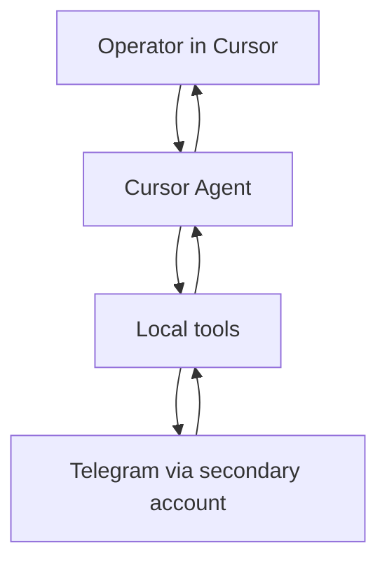

# Telegram Auth and Ask-Time Search MVP - Plan

## Goal Capsule

- **Objective:** From Cursor, the operator can sign in a secondary Telegram account once and have the agent search messages across dialogs that account already joined, instead of hunting in the Telegram UI.
- **Means:** Local Python tools (Telethon) exposed to Cursor Agent; ask-time live Telegram search with no local message index in this slice.
- **Product authority:** This plan owns auth + dialog listing + ask-time search only. Listings, publishing, monitoring, and semantic index are surrounding work, not active scope.
- **Open blockers:** None.

---

## Product Contract

### Summary

A local Cursor-facing assistant authenticates a secondary Telegram user account and, on demand, searches dialogs that account already has access to. Results come back to the agent with enough context to cite originals. No product catalog, no publishing, no background watchers in this slice.

### Problem Frame

Buyer and topic signals live in Telegram groups the operator already joined, but finding them means manual UI search. That breaks flow when the real work happens in Cursor. Automating the main personal account is an unacceptable blast radius; a secondary account plus agent-driven search is the safer first cut.

### Key Decisions

- **Scope is auth + ask-time search only** (session-settled: user-directed — chosen over full sales MVP loop with CSV/listings: publish is a later brainstorm). Governs R1–R6.
- **Ask-time live Telegram search, no local message index** (session-settled: user-approved — chosen over index-first and pinned-chat hybrid: prove Cursor→Telegram value first). Governs R4, R5.
- **Python + Telethon for this MVP** (session-settled: user-directed — chosen over TypeScript mtcute/teleproto: mature personal-account MTProto outweighs single-language preference at start). Governs R1, R4.
- **Secondary account only** (session-settled: user-directed — chosen over main-account automation: limit ban/session risk). Governs R1, R7.
- **Search only dialogs already joined** (session-settled: user-directed — chosen over auto-join or curated join workflows: account membership is a precondition). Governs R3, R4.
- **First login may require manual code/QR outside pure chat** (session-settled: user-approved — accepted as MVP friction). Governs R2.
- **Search semantics default to Telegram native search scoped by chat when requested** (session-settled: user-approved — affirmed over recent-history scan as the default meaning of “search”). Governs R4, R5.

<!-- ce-section: work-relationships -->
### How This Work Fits Together

This plan covers **Telegram auth + ask-time search**. The broader sales/intelligence assistant idea is current understanding, not a committed roadmap.

- **Telegram foundation (this plan)** — auth, list accessible dialogs, ask-time search
  - **Enables:** listings/publishing brainstorm
  - **Enables:** local index / FTS / embeddings later
  - **Enables:** monitoring and digests later
- **Listings & publish (next candidate)** — CSV → draft → confirm → publish
  - **Depends on:** this plan’s authenticated personal-account access
  - **Can proceed independently of:** monitoring, semantic search
- **Local index & semantic buyer matching (later candidate)** — FTS/embeddings over synced history
  - **Depends on:** this plan’s dialog access; may replace or wrap ask-time search
- **Monitoring & digests (later candidate)** — watch joined chats
  - **Depends on:** this plan’s session and dialog access
  - **Still to decide:** whether digests stay pull-only in Cursor or need a long-running watcher

### Actors

- A1. **Operator** — human using Cursor; owns the secondary Telegram account and decides which queries to run.
- A2. **Cursor Agent** — invokes local tools and presents findings in natural language.
- A3. **Secondary Telegram account** — MTProto user session used for all Telegram access in this product slice.

### Requirements

**Access and session**

- R1. The system authenticates A3 as a Telegram user (MTProto personal account), not as a bot.
- R2. First-time login may require a one-time manual step (phone code or QR); after success, the session persists so routine use does not repeat that step.
- R3. The system can list dialogs A3 already has access to (groups, channels, and private chats the account has joined or opened).

**Ask-time search**

- R4. On operator request via A2, the system runs Telegram native search against accessible dialogs, optionally limited to named chats from R3.
- R5. Search results include enough to act: message text (or excerpt), originating dialog, and a way to open or cite the original message.
- R6. Search is pull-based (ask-time): no requirement to sync or retain a full local message corpus in this slice.

**Safety**

- R7. The product assumes A3 is not the operator’s primary Telegram account; tooling and docs must not encourage using the main account for this MVP.
- R8. The system must not join new groups or bypass Telegram rate limits as part of search; FloodWait and access limits are surfaced, not worked around.

### Key Flows

- F1. First-time session
  - **Trigger:** Operator asks to connect Telegram; no usable session exists.
  - **Actors:** A1, A2, A3
  - **Steps:** Agent starts auth; operator completes code/QR when prompted; session is stored for reuse; agent confirms connected identity at a safe level of detail.
  - **Outcome:** Subsequent tool calls can use A3 without repeating full login.
  - **Covered by:** R1, R2, R7

- F2. List accessible dialogs
  - **Trigger:** Operator asks what chats are available or which chats to search.
  - **Actors:** A1, A2, A3
  - **Steps:** Agent lists dialogs A3 can access; operator may name a subset for the next search.
  - **Outcome:** Operator knows the searchable surface.
  - **Covered by:** R3

- F3. Ask-time search
  - **Trigger:** Operator asks to find messages (topic, keywords, buyer-intent phrasing) across all accessible dialogs or a named subset.
  - **Actors:** A1, A2, A3
  - **Steps:** Agent invokes native Telegram search with optional chat filter; returns ranked/relevant hits with citeable context; if Telegram limits or denies access, agent reports that plainly.
  - **Outcome:** Operator can continue in Cursor without opening Telegram UI for that query.
  - **Covered by:** R4, R5, R6, R8

### Acceptance Examples

- AE1. Fresh machine, no session
  - **Covers:** R1, R2
  - **Given:** No stored session for A3
  - **When:** Operator asks to connect Telegram
  - **Then:** Auth path runs including a manual code/QR step if required, and a later reconnect uses the stored session without repeating that step

- AE2. Search only joined dialogs
  - **Covers:** R3, R4, R8
  - **Given:** A3 is in group G and not in group H
  - **When:** Operator asks to search for a keyword across available chats
  - **Then:** Results may include G and must not require joining H; H is simply out of reach

- AE3. Scoped native search with citeable hits
  - **Covers:** R4, R5
  - **Given:** A3 can access named chats C1 and C2
  - **When:** Operator asks to search C1 for a phrase that exists there
  - **Then:** Agent returns at least one hit with text/excerpt, dialog identity, and a way to open or cite the original

- AE4. Rate limit honesty
  - **Covers:** R8
  - **Given:** Telegram returns a wait/limit condition
  - **When:** A search or list call hits that condition
  - **Then:** The agent reports the limit instead of retry-spamming or claiming success

### Success Criteria

- Operator prefers asking Cursor for a joined-chat search over opening Telegram UI for the same task.
- After one successful login, a normal session of list + search works without re-auth.
- Failures from access or FloodWait are understandable; the agent does not invent results from chats A3 cannot see.

### Scope Boundaries

**Deferred for later**

- CSV product import, listing generation, confirm-and-publish
- Local message index (FTS), embeddings, semantic buyer matching
- Background monitoring, keyword watchers, daily digests
- Multi-account management UI

**Outside this product’s identity (this slice)**

- Bot-API-only assistants that cannot act as a joined user in personal/group history
- Using the operator’s primary Telegram account as the automation identity
- Global Telegram search beyond what A3’s membership and Telegram APIs allow
- VPS / always-on hosted deployment as a requirement for v1 of this slice

### Dependencies / Assumptions

- Operator will use a secondary Telegram account and will already have joined target chats on that account.
- Work runs locally (e.g. Cursor + local process / devcontainer); no always-on server is required for this slice.
- Concrete first production query and chat set will be chosen at first real use; they are not fixed in this contract.
- Telegram API credentials (api_id / api_hash) and session material stay out of git and are supplied locally.

### Outstanding Questions

**Deferred to Planning**

- Exact Telethon APIs and MCP tool surface for auth, list dialogs, and search
- Session file location, secrets handling, and .gitignore / protected paths
- How code/QR prompts are surfaced inside Cursor/devcontainer UX
- Result payload shape (deep links vs message ids vs copied excerpts) beyond R5’s intent
- Whether TypeScript returns later as a rewrite once the product loop is proven
